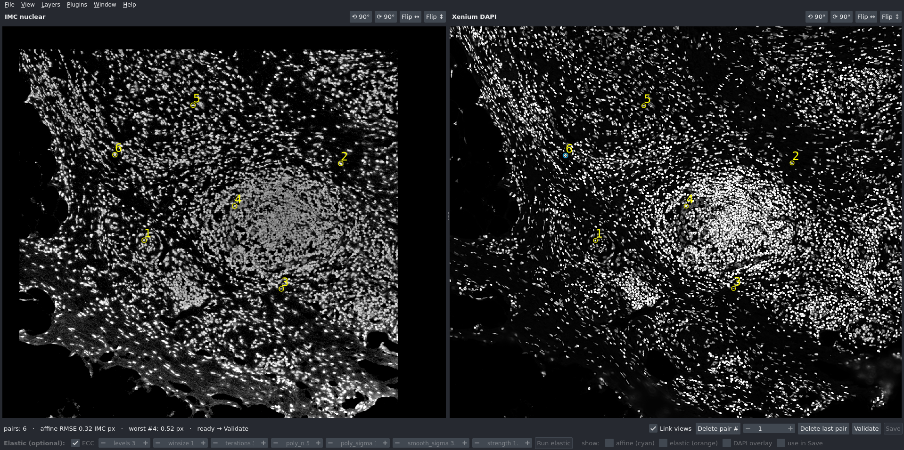
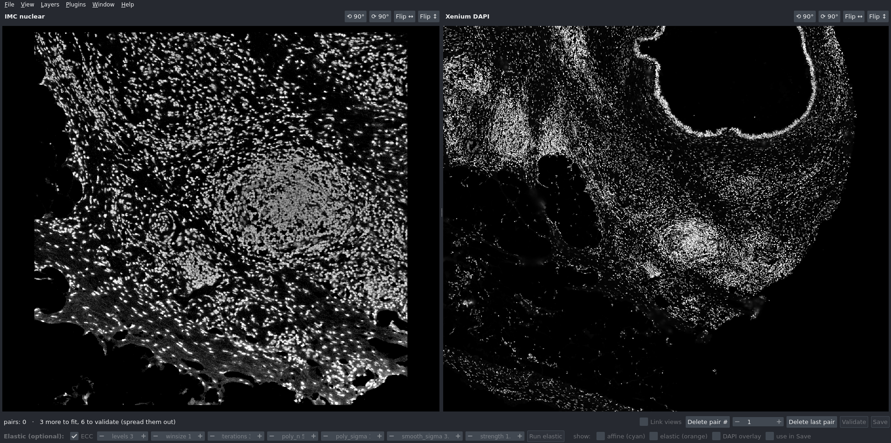
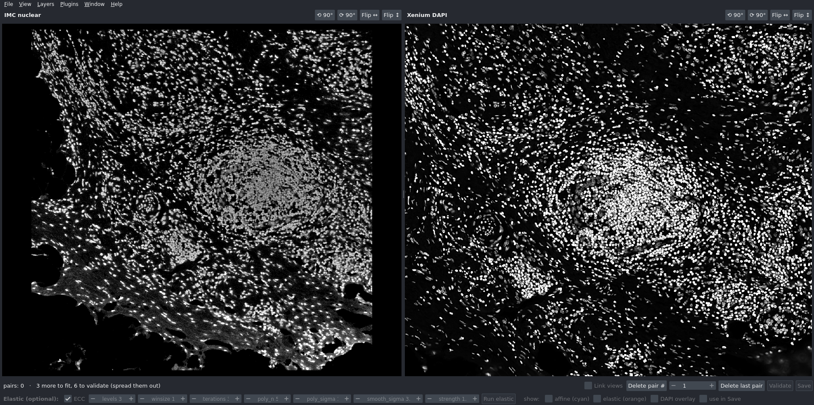
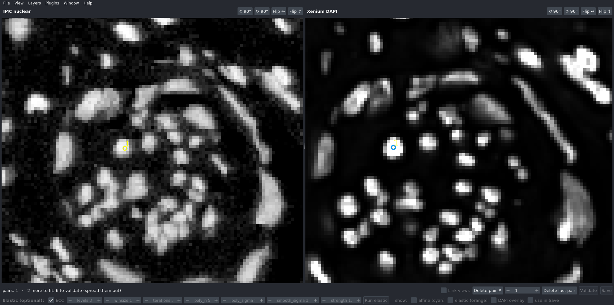
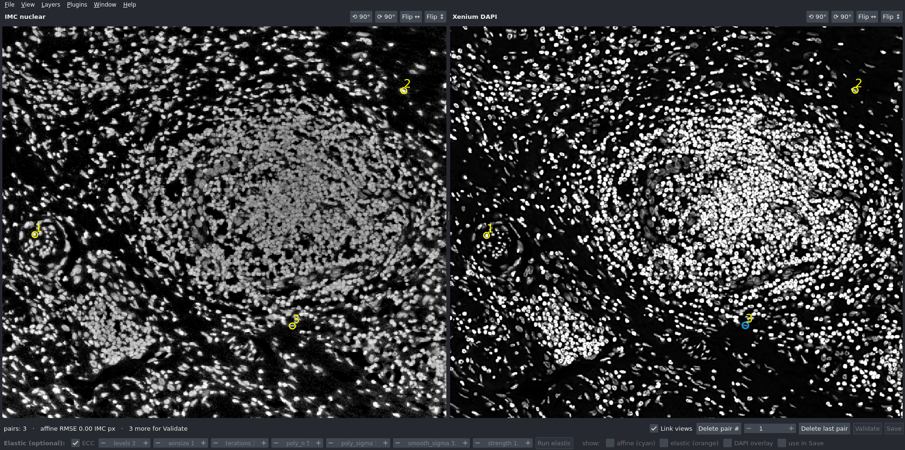
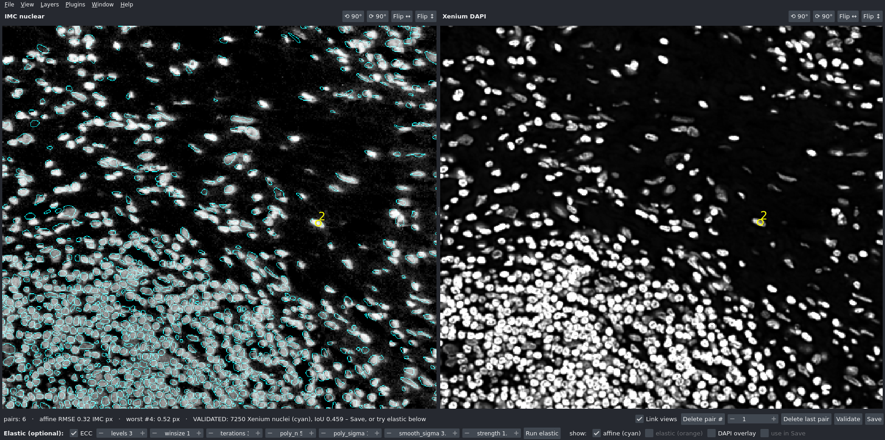
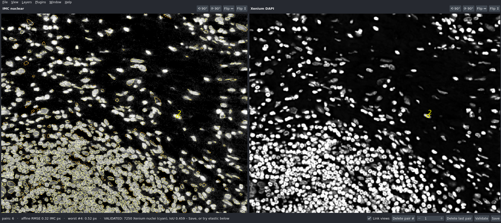

# IMC ↔ Xenium landmark alignment

An interactive tool for registering a **10x Genomics Xenium** section onto an **Imaging Mass Cytometry (IMC)** region of interest. You click matching nuclei in the two images. The tool fits a transform, shows you how well the Xenium nuclear segmentation lands on the IMC nuclei, and can refine the result with an optional elastic (non-linear) step. The output maps Xenium coordinates (cells, nuclei, transcripts) into **native IMC pixel coordinates**, so the IMC data is never resampled.

The viewer layout and workflow are **inspired by the image alignment tool in 10x Genomics' Xenium Explorer**: two images side by side, matching landmarks clicked on each, then a preview of the fit before accepting it. This tool is written in Python on top of [napari](https://napari.org) and is not affiliated with 10x Genomics.



---

## Contents

1. [What you need](#1-what-you-need)
2. [One-time installation](#2-one-time-installation)
3. [Point the tool at your data](#3-point-the-tool-at-your-data)
4. [Run it](#4-run-it)
5. [Step-by-step walkthrough](#5-step-by-step-walkthrough)
6. [Output files](#6-output-files)
7. [How it works](#7-how-it-works)
8. [Settings reference](#8-settings-reference)
9. [Troubleshooting](#9-troubleshooting)
10. [Credits](#10-credits)

---

## 1. What you need

**Computer:** Linux, macOS or Windows. 16 GB of RAM is comfortable.

**Data for one ROI:**

| File | Where it comes from | Notes |
|---|---|---|
| IMC image, e.g. `roi_001.tiff` | IMC export (one TIFF per ROI, all channels stacked) | The DNA channels **Ir191 / Ir193** are used. In our panel they are channels 37 and 38, counting from 0. |
| `morphology_focus/` folder | Xenium output bundle | Only `ch0000_dapi.ome.tif` is read. |
| `nucleus_boundaries.parquet` | Xenium output bundle | Optional, but needed for the Validate overlay. Coordinates are in µm. |

**Folder layout** (this repository):

```
IMC_Xenium_alignment/
├── README.md                ← this file
├── environment.yml          ← list of software to install
├── config.py                ← the ONLY file you normally edit
├── run_alignment.py         ← the program you start
├── imc_xenium_align.py      ← viewer + maths (no need to touch)
├── elastic.py               ← elastic step (no need to touch)
├── images/                  ← screenshots used in this README
└── outputs/                 ← results are written here
```

Your data can live anywhere on your computer; you tell the tool where it is in `config.py`. Keep data out of this folder if you put it under version control.

---

## 2. One-time installation

You only do this once per computer. It installs Python and all required packages into a self-contained **conda environment** called `imc_xenium_align`, so nothing else on your computer is changed.

### 2a. Install Miniforge (skip if you already have conda or mamba)

Miniforge is a small, free installer for conda.

- **Windows:** download `Miniforge3-Windows-x86_64.exe` from <https://github.com/conda-forge/miniforge/releases/latest> and run it with the default options. Then open **"Miniforge Prompt"** from the Start menu and use it for every command below.
- **macOS / Linux:** open a **Terminal** and run:

  ```bash
  curl -L -O "https://github.com/conda-forge/miniforge/releases/latest/download/Miniforge3-$(uname)-$(uname -m).sh"
  bash Miniforge3-$(uname)-$(uname -m).sh
  ```

  Answer `yes` to the licence and to "initialize conda". Then **close the terminal and open a new one**.

To check it worked, run:

```bash
conda --version
```

It should print something like `conda 24.x`.

### 2b. Create the environment

In the terminal (Windows: Miniforge Prompt), go to the `IMC_Xenium_alignment` folder and create the environment from `environment.yml`:

```bash
cd /path/to/IMC_Xenium_alignment
conda env create -f environment.yml
```

- On Windows the path looks like `cd C:\Users\you\IMC_Xenium_alignment`.
- Tip: in most terminals you can type `cd ` (with a space) and then drag the folder onto the window to paste its path.

This downloads about 1 GB and takes a few minutes. At the end it prints `conda activate imc_xenium_align`.

**Updating later:** if `environment.yml` changes, run:

```bash
conda env update -f environment.yml --prune
```

---

## 3. Point the tool at your data

Open `config.py` in any text editor (Notepad, TextEdit, VS Code …) and replace the three placeholder paths at the top with the locations of your files:

```python
IMC_PATH    = '/path/to/imc_roi.tiff'
MORPH_DIR   = '/path/to/xenium_output/morphology_focus'
NUCLEI_PATH = '/path/to/xenium_output/nucleus_boundaries.parquet'   # or None
```

- Write the full path in quotes, e.g. `IMC_PATH = '/data/imc/roi_001.tiff'`. On Windows, put an `r` before the quotes: `r'C:\data\imc\roi_001.tiff'`.
- If a path is wrong (or still the placeholder), `run_alignment.py` stops straight away and tells you which one.
- Results go to the `outputs/` folder next to the code (`OUT_DIR`).
- If your IMC panel stores DNA in different channels, change `IMC_NUC_CHANNELS = (37, 38)`. Channel numbers count from 0.
- To align another ROI, change `IMC_PATH` (and the Xenium paths, if it is a different Xenium region) and run again. Each ROI gets its own output files, named after the IMC file.

---

## 4. Run it

Every time you want to use the tool:

```bash
conda activate imc_xenium_align
cd /path/to/IMC_Xenium_alignment
python run_alignment.py
```

Loading takes a few seconds (`loading IMC … loading DAPI pyramid … loading Xenium nucleus boundaries …`), then the window opens. Close the window when you are done; there is nothing else to shut down.

You can also keep several config files, one per ROI, and pass one in:

```bash
python run_alignment.py config_roi_002.py
```

---

## 5. Step-by-step walkthrough

### Step 1: The initial scene



- **Left:** the IMC nuclear image (Ir191 + Ir193).
- **Right:** the Xenium DAPI image of the **whole Xenium region**. It is much larger than the IMC ROI, so first find the area that matches the IMC image.

Controls:
- **Zoom:** mouse wheel.
- **Pan:** click and drag.
- **Orientation:** each panel has four buttons, **⟲ 90°**, **⟳ 90°**, **Flip ↔** and **Flip ↕**. They only change how that image is *displayed*. They help you recognise the tissue but do not affect the result.

### Step 2: Find the matching region and orient it



Rotate or flip the DAPI panel until the tissue looks the same as on the IMC side, then zoom in to the matching area. Here the DAPI was rotated so that the large round structure and the vessel to its lower left sit in the same place in both panels.

### Step 3: Place the first landmark pair



Zoom in until you can see single nuclei. **Click a nucleus on the left (IMC)**, then **click the same nucleus on the right (DAPI)**. Each pair gets the same number. The markers stay small at any zoom so you can see exactly where you clicked.

Good landmarks are distinctive nuclei you can recognise unambiguously in both images: isolated nuclei, the ends of a vessel wall, small clusters. Avoid crowded areas where neighbours look alike.

### Step 4: Three pairs, and the views start to follow each other



From **3 pairs** on, the tool fits a transform and turns on **Link views**:
- Panning or zooming one panel moves the other to the same tissue at the same physical scale.
- After each click, the other panel jumps to where the fit predicts the matching nucleus, so the remaining pairs are much quicker to place.

The status line shows the fit error (`affine RMSE`) in IMC pixels.

### Step 5: Six or more pairs, spread over the ROI


Place at least **6 pairs**. Three are the mathematical minimum, but more pairs average out small clicking errors.

**Spread them over the whole ROI** (corners and centre), not in one cluster.

The status line shows the RMSE and the **worst pair**, e.g. `affine RMSE 0.32 IMC px · worst #4: 0.52 px`. Hover over the status line for every pair's error. If one pair is much worse than the rest, it was probably mis-clicked: remove it with **Delete pair #** (pick its number) or **Delete last pair**.

### Step 6: Validate the affine fit



Click **Validate**. The Xenium nuclear segmentation is transformed with the current fit and drawn in **cyan** on the IMC image. Only nuclei that lie **completely inside** the IMC ROI are drawn; the Xenium region contains many more nuclei than the IMC ROI.

The status line reports how many Xenium nuclei fall inside the ROI and an overlap score (**IoU**, see [How it works](#7-how-it-works)), e.g. `VALIDATED: 7250 Xenium nuclei (cyan), IoU 0.459`.

Zoom around the whole ROI and check that the cyan outlines sit on the IMC nuclei. If they look good, you can **Save** now. If you add or delete a pair afterwards, the validation is cleared and you need to Validate again.

### Step 7 (optional): Elastic refinement



Tissue sections are rarely deformed in a perfectly linear way, so an affine fit can be very good in one part of the ROI and a few µm off in another. The **Elastic (optional)** row under the main buttons adds a smooth, local correction on top of the affine fit:

1. Click **Run elastic**. It takes about a second.
2. Compare before and after with the **show:** checkboxes: **affine (cyan)** and **elastic (orange)** outlines, plus a **DAPI overlay** (the warped Xenium DAPI in green on top of IMC).
3. The status shows e.g. `IoU affine 0.459 → elastic 0.588 · max |flow| 27.6 px`.
4. If it looks worse, or too wobbly, change the settings and click **Run elastic** again as often as you like. Each run replaces the previous result. See [Elastic settings](#elastic-settings) for what to change.
5. **use in Save** decides what gets saved. It is ticked automatically after a run; untick it to keep the affine-only result.

### Step 8: Save

Click **Save**. Previous results for the same ROI are **overwritten**. Landmarks are not reloaded the next time you start the tool; each session starts fresh.

---

## 6. Output files

Written to `outputs/`, named after the IMC file (e.g. `roi_001.tiff` → `roi_001_alignment.json`):

| File | Content |
|---|---|
| `<ROI>_alignment.json` | Landmarks, affine matrices, fit errors, IoU, elastic settings. |
| `<ROI>_elastic_field.npz` | The elastic displacement field. Only written if elastic was used; an affine-only save deletes an old one. |
| `<ROI>_alignment_qc.png` | QC figure: IMC, warped DAPI, colour overlay with landmarks, and affine and elastic nuclei outlines with their IoU. |

Important keys in the JSON. All matrices are 2×3 in **(x, y)** order, the same convention as OpenCV `cv2.warpAffine` and FIJI:

| Key | Maps … → … |
|---|---|
| `M_dapi_um_to_imc_px` | Xenium **µm** (cells, nuclei, transcripts parquet files) → IMC pixels |
| `M_dapi_fullres_px_to_imc_px` | Xenium full-resolution morphology-image pixels → IMC pixels |
| `M_imc_px_to_dapi_um`, `M_imc_px_to_dapi_fullres_px` | the inverse directions |
| `n_pairs`, `rmse_imc_px`, `residuals_imc_px` | landmark fit quality |
| `iou_affine`, `iou_elastic`, `elastic_used`, `elastic_params` | validation scores and elastic settings |

### Using the result in Python

Use `map_xenium_um_to_imc`. It applies the affine and, if one was saved, the elastic field:

```python
import sys
sys.path.append('/path/to/IMC_Xenium_alignment')
import pandas as pd
from imc_xenium_align import load_alignment, map_xenium_um_to_imc

res = load_alignment('/path/to/IMC_Xenium_alignment/outputs/roi_001_alignment.json')

cells = pd.read_parquet('/path/to/xenium_output/cells.parquet')
xy_imc = map_xenium_um_to_imc(cells[['x_centroid', 'y_centroid']].values, res)   # (x, y) IMC px

H, W = 1000, 1000   # IMC ROI size in pixels
in_roi = (xy_imc[:, 0] >= 0) & (xy_imc[:, 0] < W) & (xy_imc[:, 1] >= 0) & (xy_imc[:, 1] < H)
cells_in_imc = cells[in_roi].assign(imc_x=xy_imc[in_roi, 0], imc_y=xy_imc[in_roi, 1])
```

Transcripts work the same way, with columns `x_location`, `y_location`.

For an **affine-only** result you can also apply the matrix directly in any language: `[x_imc, y_imc] = M · [x_um, y_um, 1]`.

---

## 7. How it works

### Image preparation

- **IMC nuclear image:** the two DNA channels are summed and compressed with `arcsinh(x / 20)`, which is standard for mass cytometry intensities. The result is contrast-stretched between the 30th and 99.5th percentile and converted to 8-bit. The high lower percentile pushes the IMC background to black.
- **Xenium DAPI:** read from the JPEG2000 image pyramid in `morphology_focus/ch0000_dapi.ome.tif`. Level 2 (4× downsampled, 0.85 µm/pixel) is used for alignment; coarser levels are shown when zoomed out so panning stays smooth. Contrast is stretched the same way.

### Coordinate frames

Everything is solved in **native IMC pixels**: the IMC image is never resampled. The rotate and flip buttons only change each panel's *display*. Landmarks are stored in each image's own pixel coordinates, so display orientation never affects the result.

### Landmark fit (affine)

Each pair *i* gives a DAPI position **d**ᵢ and an IMC position **w**ᵢ. With 3 or more pairs, the **least-squares affine transform** *A* is found that minimises

  Σᵢ ‖ A·**d**ᵢ − **w**ᵢ ‖²

An affine transform covers translation, rotation, scaling, shear and mirror flips, so Xenium and IMC can be in any orientation or at different pixel sizes. The per-pair residuals ‖A·**d**ᵢ − **w**ᵢ‖ show how consistent each pair is with the others; one large residual points to a mis-clicked landmark.

The fitted matrix is then expressed for different Xenium units, using Xenium's 0.2125 µm per full-resolution pixel:
- DAPI level-2 pixels → IMC pixels
- full-resolution pixels → IMC pixels
- µm → IMC pixels

### Linked views

Once *A* exists, moving one panel's camera moves the other panel to the corresponding point, with the zoom scaled by the transform's scale factor. Both panels then show the same tissue at the same physical size, as in Xenium Explorer's alignment tool.

### Validation

The Xenium nucleus polygons (`nucleus_boundaries.parquet`, in µm) are mapped into IMC pixels. Only nuclei whose **entire outline** lies inside the IMC ROI are kept. They are drawn at 2× IMC resolution for thin outlines.

The **IoU** (intersection over union) score compares two masks:
- IMC nuclei: pixels above an automatic (Otsu) brightness threshold in the IMC nuclear image
- Xenium nuclei: the filled Xenium nucleus polygons

IoU = overlap / combined area: 1 is perfect overlap, 0 is none. The absolute value depends on tissue density and IMC resolution (IMC is ~1 µm/pixel and blurrier than DAPI), so use it to **compare** fits on the same ROI (affine vs elastic, or before vs after fixing a landmark), not as a pass/fail threshold.

### Elastic refinement

The elastic step refines the affine result with an intensity-based correction (ECC + Farnebäck optical flow). It works on two images on the IMC pixel grid: the IMC nuclear image (fixed) and the Xenium DAPI already warped by the affine fit (moving).

1. **ECC affine refinement** (OpenCV `findTransformECC`): a small automatic affine correction that maximises the correlation between the two images. It removes any remaining global offset from clicking.
2. **Dense optical flow** (OpenCV Farnebäck): estimates a displacement for every IMC pixel, so local stretching and tearing of the section can be followed.
3. **Smoothing:** the displacement field is smoothed with a Gaussian (`smooth_sigma`) to keep it from following noise.
4. **Strength:** the field is multiplied by `strength`. 1.0 applies the full correction; smaller values apply only part of it.

The result is a backward map from each IMC pixel *x* into the affine-aligned frame:

  B(*x*) = ECC · ( *x* + flow(*x*) )

- **Images** are warped by sampling at B(*x*).
- **Points** (cells, transcripts, polygon vertices) need the opposite direction. The tool solves B(*x*) = *q* with a fixed-point iteration, accurate to well below 0.1 px.

Both are in `imc_xenium_align.py` (`warp_with_field`, `invert_points`, `map_xenium_um_to_imc`).

On a synthetic test (DAPI deformed by a known smooth field of up to 7 px), the elastic step recovered the field to a median error of 0.04 px. On a real IMC ROI it raised the nuclei IoU from 0.459 (affine) to 0.588.

The elastic computation runs in a separate short-lived Python process, so the viewer stays responsive and OpenCV never loads into the viewer process (see [Troubleshooting](#9-troubleshooting)).

---

## 8. Settings reference

All in `config.py`.

| Setting | Default | Meaning |
|---|---|---|
| `IMC_NUC_CHANNELS` | `(37, 38)` | IMC DNA channels, counting from 0 |
| `IMC_COFACTOR` | `20` | arcsinh cofactor for IMC intensities |
| `IMC_PCT`, `DAPI_PCT` | `(30, 99.5)` | contrast stretch percentiles (raise the first number for a darker background) |
| `DAPI_LEVEL` | `2` | Xenium pyramid level used for alignment (2 = 4× downsampled, 0.85 µm/px) |
| `NUCLEI_PATH` | `nucleus_boundaries.parquet` | set to `None` if you don't have it (Validate then only unlocks Save) |

### Elastic settings

These are the starting values of the controls in the viewer, under `ELASTIC = dict(...)` in `config.py`. You can change them in the viewer and re-run.

| Control | Default | Effect / when to change |
|---|---|---|
| ECC | on | Automatic affine touch-up before the flow. If the status says it did not converge, the identity is used; try unticking it. |
| `levels` | 3 | Pyramid levels of the flow. More levels can follow larger displacements. |
| `winsize` | 15 | Size of the neighbourhood that moves together. **Larger** (25–51) gives a smoother, more conservative warp; smaller follows finer detail but also noise. |
| `iterations` | 3 | Flow iterations per level. |
| `poly_n`, `poly_sigma` | 5, 1.2 | Farnebäck polynomial fit; use 7 and 1.5 for smoother flow. |
| `smooth_sigma` | 3 px | Extra Gaussian smoothing of the displacement field. Raise it if outlines look wobbly. |
| `strength` | 1.0 | Fraction of the estimated correction that is applied. Lower it to apply only part of the correction. (The original H&E/IF implementation used 0.1.) |

Rule of thumb: if the elastic outlines are better in some places but distorted in others (especially at tissue edges or empty areas), raise `winsize` and/or `smooth_sigma`. If the IoU barely improves, the affine fit was already as good as the images allow, and saving affine only is fine.

---

## 9. Troubleshooting

| Problem | Fix |
|---|---|
| `conda: command not found` | Open a **new** terminal after installing Miniforge. On Windows, use **Miniforge Prompt**. |
| `ModuleNotFoundError: No module named 'napari'` (or similar) | You forgot `conda activate imc_xenium_align`. |
| `could not load the Qt platform plugin "xcb"` / window never opens | Another OpenCV build (`opencv-python`) is installed in the environment and brings its own Qt. Use the provided environment, which has `opencv-python-headless`. `run_alignment.py` already guards against this. |
| The notebook kernel dies when starting the viewer | Start the viewer from a terminal with `python run_alignment.py`, not from Jupyter. |
| `Please edit the input paths in config.py` / `FileNotFoundError` at start | Check the paths in `config.py`; on Windows use `r'C:\…'`. |
| **Validate** is greyed out | It needs 6 complete pairs (a point on *both* sides). The status line says which side is waiting. |
| **Save** is greyed out | Click **Validate** first. Adding or deleting a pair clears the validation. |
| Elastic result has distorted outlines near the tissue edge | Raise `winsize` / `smooth_sigma`, or lower `strength`, then **Run elastic** again. Or untick **use in Save** to save affine only. |

---

## 10. Credits

- Viewer workflow inspired by the **image alignment tool in 10x Genomics Xenium Explorer** (side-by-side landmark selection with a live preview). Independent re-implementation, not affiliated with 10x Genomics.
- Built with [napari](https://napari.org), [scikit-image](https://scikit-image.org), [SciPy](https://scipy.org), [tifffile](https://github.com/cgohlke/tifffile) and [OpenCV](https://opencv.org).
